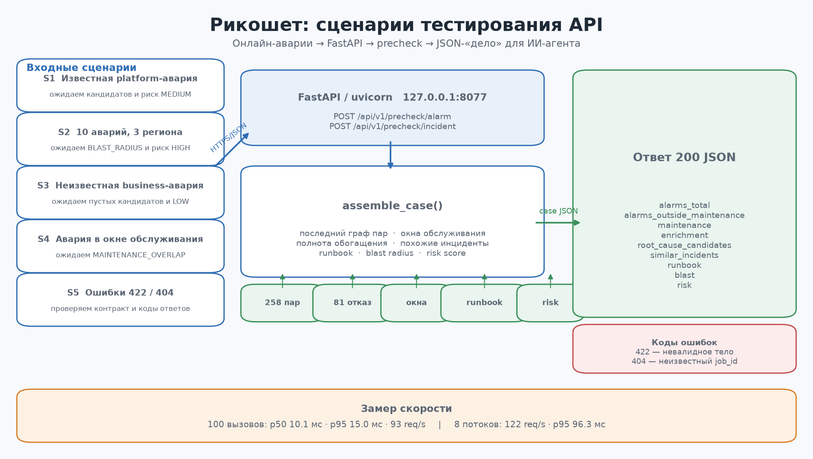
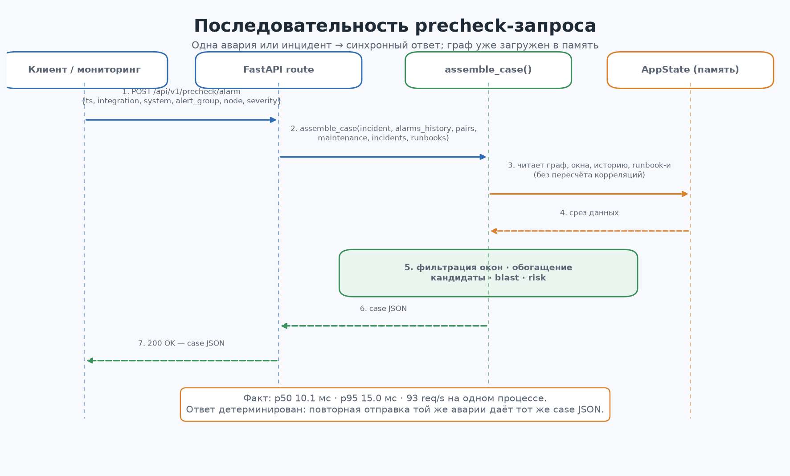
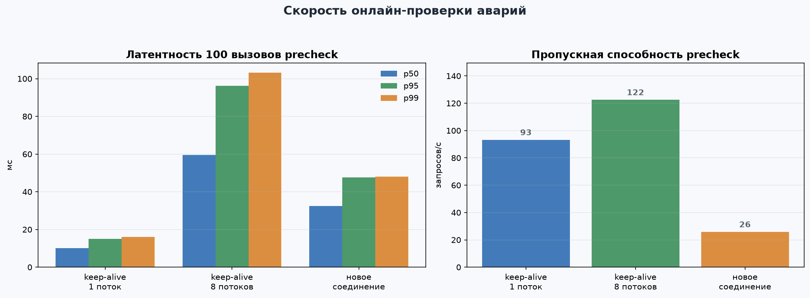
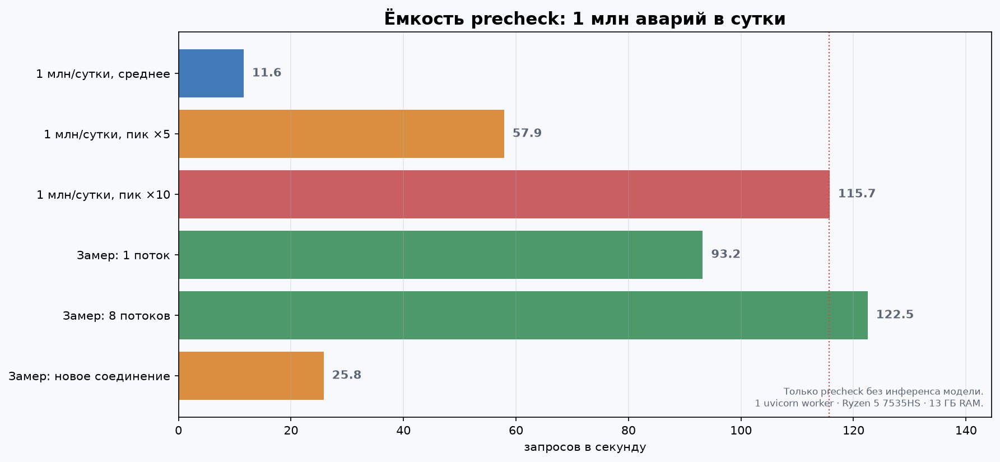

# Тестирование API «Рикошета»

Документ фиксирует сценарии онлайн-отправки аварий в API, ожидаемые и фактические ответы, а также замер скорости на 100 вызовах. Все числа получены на локальном экземпляре `http://127.0.0.1:8077` с реальными данными AIOps Challenge 2020.



## 1. Стенд и исходное состояние

| Параметр | Значение |
|---|---|
| API | FastAPI + uvicorn, `127.0.0.1:8077`, один worker |
| Swagger | `http://127.0.0.1:8077/docs` |
| Данные | `alarms.parquet`, 4 731 050 аварий, апрель–май 2020 |
| Граф | `state/butterfly_last.json`, 258 пар, 50 узлов |
| История | `incidents.json`, 81 размеченный отказ |
| Окна обслуживания | 0 на старте теста |
| Runbook-и | 0 на старте теста |
| Машина | AMD Ryzen 5 7535HS, 6 ядер / 12 потоков, 13,3 ГБ RAM, Python 3.12.2 |

`GET /health` до начала сценариев:

```json
{
  "status": "ok",
  "alarms": 4731050,
  "synthetic": false,
  "months": ["2020-04", "2020-05"],
  "pairs_last": 258,
  "maintenance_windows": 0,
  "historical_incidents": 81,
  "ranker": {
    "model_kind": "heuristic",
    "model_version": "heuristic-v1",
    "feedback": 0
  }
}
```

Полные результаты: [`api_test_results.json`](api_test_results.json). Скрипты: [`test_api_scenarios.py`](../scripts/test_api_scenarios.py), [`make_api_diagrams.py`](../scripts/make_api_diagrams.py).

## 2. Что происходит внутри precheck



1. Клиент отправляет одну аварию в `POST /api/v1/precheck/alarm` или инцидент в `POST /api/v1/precheck/incident`.
2. FastAPI передаёт данные в `assemble_case()`.
3. `assemble_case()` читает из памяти последний граф пар, окна обслуживания, исторические инциденты и runbook-и. Полный пересчёт корреляций не выполняется.
4. Считаются: фильтрация окон, полнота обогащения, похожие инциденты, кандидаты-первопричины, blast radius и risk score.
5. Возвращается JSON-«дело» с кодом `200`. Ошибки контракта — `422`, неизвестный `job_id` — `404`.

Ключевой вывод: precheck — синхронный и детерминированный. Повторная отправка той же аварии даёт тот же ответ, пока не изменились граф, окна или runbook-и.

## 3. Сценарии

`latency_ms` в сценариях — одиночный вызов с новым TCP-соединением; сравнение режимов keep-alive и параллельных вызовов — в разделе 4.

### S1. Известная platform-авария

Проверяем, что система находит скрытую зависимость и поднимает риск.

```json
{
  "ts": "2020-04-24T10:15:00",
  "integration": "platform",
  "system": "os_linux",
  "alert_group": "Sent_packets_high",
  "node": "os_linux_01",
  "region": "MSK",
  "severity": 4
}
```

Фактический ответ: `200`, risk `40 / MEDIUM`, кандидатов `5`.

| Поле | Значение |
|---|---|
| `enrichment.completeness` | `0,8333` |
| `maintenance.hit` | `false` |
| `runbook` | `null` |
| `blast` | `nodes=1, regions=1, max_severity=4` |
| `risk.flags` | `BUTTERFLY_LINKED` (25), `HIGH_SEVERITY` (15) |
| Топ-кандидат | `db_oracle_11g|AIOS_high`, score `0,7058`, предсказывает `Sent_packets_high` |

Ожидаемо: авария ведомого поднимает кандидата-лидера, даже если лидера нет в самом инциденте.

### S2. Инцидент с blast radius

Десять аварий, десять узлов, три региона, максимальная критичность. Ниже — фрагмент; в реальном запросе 10 аварий с разными `node` и `region`.

```json
{
  "incident_id": "BLAST-10",
  "region": "MSK",
  "alarms": [
    {"ts": "2020-04-24T10:00:00", "integration": "platform", "system": "os_linux",
     "alert_group": "Sent_packets_high", "node": "os_linux_00", "region": "MSK", "severity": 4}
  ]
}
```

Фактический ответ: `200`, `alarms_total=10`, risk `60 / HIGH`, кандидатов `5`.

| Поле | Значение |
|---|---|
| `blast` | `nodes=10, regions=3, max_severity=4` |
| `risk.flags` | `BUTTERFLY_LINKED` 25, `BLAST_RADIUS` 20, `HIGH_SEVERITY` 15 |
| `maintenance.hit` | `false` |

Ожидаемо: при `nodes >= 10` или `regions >= 3` добавляется `BLAST_RADIUS`; сумма флагов переводит риск в `HIGH`.

### S3. Неизвестная business-авария

Проверяем отсутствие ложных кандидатов и полное обогащение.

```json
{
  "ts": "2020-04-24T10:20:00",
  "integration": "business",
  "system": "esb",
  "alert_group": "CSF_fail",
  "node": "esb_01",
  "node_alias": "esb-alias",
  "region": "SPB",
  "severity": 3
}
```

Фактический ответ: `200`, risk `0 / LOW`, кандидатов `0`.

| Поле | Значение |
|---|---|
| `enrichment.completeness` | `1,0` |
| `maintenance.hit` | `false` |
| `runbook` | `null` |
| `blast` | `nodes=1, regions=1, max_severity=3` |
| `risk.flags` | `[]` |

Ожидаемо: авария не входит в платформенный граф, поэтому кандидатов нет. Низкая критичность не поднимает риск.

### S4. Авария в окне обслуживания

Создаём окно, отправляем аварию внутрь окна, затем удаляем окно.

```json
{
  "start": "2020-04-24T09:00:00",
  "end": "2020-04-24T11:00:00",
  "region": "MSK",
  "system": "os_linux",
  "node": "os_linux_05",
  "note": "api test scenario"
}
```

Авария: та же, что в S1, но `node=os_linux_05`, `region=MSK`, `ts=2020-04-24T10:15:00`.

Фактический ответ: `200`, `maintenance.hit=true`, `alarms_outside_maintenance=0`, risk `70 / HIGH`.

| Флаг | Вес |
|---|---:|
| `MAINTENANCE_OVERLAP` | 30 |
| `BUTTERFLY_LINKED` | 25 |
| `HIGH_SEVERITY` | 15 |

Ожидаемо: авария помечается как попадающая в окно и исключается из рабочего потока. Окно удалено через `DELETE /api/v1/maintenance/windows/{id}`; состояние восстановлено.

### S5. Повторная отправка

Одна и та же авария отправлена дважды. Ответы полностью совпали: `identical=true`, risk `40`. Это важно для ретраев: повтор не создаёт побочных эффектов и не меняет «дело».

### S6. Невалидное тело

Запрос без `ts`:

```json
{"integration": "platform", "system": "os_linux", "alert_group": "X"}
```

Фактический ответ: `422`, `detail[0].type = "missing"`, поле `ts`. Ожидаемо: Pydantic/FastAPI отбрасывает запрос до бизнес-логики.

### S7. Неизвестный job

`GET /api/v1/butterfly/jobs/does-not-exist` → `404`, `{"detail":"job does-not-exist not found"}`. Ожидаемо: job-и живут в памяти и не переживают рестарт.

### S8. Граф и проверка пары

`GET /api/v1/butterfly/pairs?limit=1` вернул `258` пар. Первая пара:

- `db_oracle_11g|AIOS_high` ↔ `os_linux|Sent_packets_high`;
- класс `BUTTERFLY_CANDIDATE`.

`POST /api/v1/butterfly/verify` для этой пары:

```json
{
  "overlap": {
    "devices_a": 11,
    "devices_b": 13,
    "common": 0,
    "overlap_frac": 0.0,
    "verdict": "NO_OVERLAP"
  },
  "shared_unshared": {
    "corr_all": 0.8393,
    "corr_shared": null,
    "corr_unshared": 0.8393,
    "verdict": "NO_COMMON_DEVICES"
  }
}
```

`GET /api/v1/butterfly/graph` вернул `50` узлов и `258` рёбер. Ожидаемо: в platform-слое `db_*` и `os_*` не пересекаются по `cmdb_id`, поэтому вердикт — `NO_COMMON_DEVICES`.

Каждая пара в ответе `/butterfly/pairs` содержит блок `xgboost`:
`probability`, `decision` (`pass`/`review`/`drop`), `rank`, `model_kind`,
`model_version`, `threshold` и снимок 35 признаков. Пары отсортированы по
вероятности ранжировщика, а не по `score` движка.

### S9. Обратная связь и обучение XGBoost

`GET /api/v1/ranker/status` до обучения возвращает `model_kind=heuristic`,
`xgboost_installed=true`, `feedback.total=0`.

Метка эксперта для пары:

```json
{
  "pair_id": "platform|db_oracle_11g|AIOS_high<->platform|os_linux|Sent_packets_high",
  "label": "good",
  "source": "ui",
  "comment": "подтверждено на разборе"
}
```

`POST /api/v1/ranker/feedback` → `200`, метка и снимок признаков сохранены в
`state/ranker_feedback.json`. Для демонстрации можно добавить одну метку
`spam`, затем вызвать:

```json
POST /api/v1/ranker/train
{"force": true}
```

Ответ содержит `result.trained=true`, `metrics` и `top_features`; повторный
`GET /api/v1/ranker/status` показывает `model_kind=xgboost` и версию модели.
После обучения `POST /api/v1/precheck/incident` пересчитывает вероятности
текущей моделью и возвращает блок `ranker` с `threshold`, `selected`,
`fallback`. При отсутствии пар выше `0.9` включается явный fallback, а не
пустое дело.

## 4. Скорость на 100 вызовах

### Методика

- Эндпоинт: `POST /api/v1/precheck/incident` с одной аварией внутри.
- 10 прогревочных вызовов исключены.
- Основной замер: 100 вызовов, keep-alive, один поток.
- Дополнительно: 100 вызовов, 8 параллельных соединений; 100 вызовов с новым TCP-соединением на каждый запрос.
- Время — end-to-end на клиенте, включая HTTP и JSON. Сервер — локальный, один uvicorn worker.

### Результаты

| Режим | p50, мс | p95, мс | p99, мс | req/s |
|---|---:|---:|---:|---:|
| keep-alive, 1 поток | 10,1 | 15,0 | 16,1 | 93,2 |
| keep-alive, 8 потоков | 59,5 | 96,3 | 103,2 | 122,5 |
| новое соединение на запрос | 32,4 | 47,6 | 48,0 | 25,8 |



Интерпретация:

- При повторном использовании соединения один поток даёт ~93 запроса/с при p95 ≈ 15 мс.
- Восемь потоков поднимают пропускную способность до ~122 запросов/с, но p95 растёт до ~96 мс: один процесс насыщается, запросы ждут в очереди.
- Новое TCP-соединение на каждый вызов режет throughput до ~26 запросов/с. Для потока аварий нужен connection pooling или HTTP/2, иначе клиентская цена соединения доминирует.
- Внутри одного запроса precheck почти не зависит от числа аварий: 1 авария — 7,1 мс, 10 — 7,6 мс, 50 — 9,4 мс, 100 — 13,1 мс (mean, keep-alive).

### Что это значит для 1 млн аварий в сутки

1 000 000 / 86 400 ≈ **11,6 аварии/с** в среднем. Пики:

| Нагрузка | Запросов/с |
|---|---:|
| среднее за сутки | 11,6 |
| пик ×5 | 57,9 |
| пик ×10 | 115,7 |



Вывод для текущего precheck:

- среднее и пик ×5 покрываются с запасом даже при 93 req/s;
- пик ×10 (~116 req/s) находится на пределе одного worker-а и требует keep-alive/нескольких процессов;
- при одном новом соединении на аварию потолок ~26 req/s, этого не хватит даже на пик ×5;
- если аварии приходят пачками по 10–100 штук в одном инциденте, число HTTP-вызовов падает в 10–100 раз, а нагрузка на precheck остаётся низкой.

Важно: это скорость текущего детерминированного precheck без инференса ML-модели. Для «более обученной модели» эти числа нельзя переносить напрямую.

## 5. Если добавить модель и квантование

Сейчас в API нет тяжёлой ML-модели: граф и правила считаются заранее. Если добавить модель (классификатор первопричины, ranker, LLM-агент), итоговая latency = HTTP + feature pipeline + model inference + postprocessing. Квантование ускоряет только inference, поэтому сначала нужно понять его долю.

| Формат | Память | Ожидаемое ускорение inference | Риски |
|---|---:|---:|---|
| FP32 | 1× | 1× | базовая точность |
| FP16 / BF16 | ~0,5× | ~1,5–2× | минимальные, обычно безопасно |
| INT8 | ~0,25× | ~2–4× | нужна калибровка, возможна просадка на редких классах |
| INT4 | ~0,125× | ~2–3× (не 8×) | заметный риск точности, нужен QAT/групповое квантование |

Практический порядок:

1. **Профилировать end-to-end.** Если модель занимает 20% latency, ускорение модели в 2 раза даст лишь ~1,11× общего выигрыша (закон Амдала).
2. **Сначала батчинг и очередь.** Для 1 млн/сутки важнее собрать аварии в батчи, разнести по воркерам и включить backpressure, чем квантовать маленькую модель.
3. **FP16/BF16 — безопасный первый шаг.** Часто даёт ~2× по памяти и вычислениям почти без потери качества.
4. **INT8 — после калибровки.** Проверять не только accuracy, но и recall на редких причинах и p99 latency.
5. **INT4 — только если есть запас по качеству.** Для табличных/временных рядов выигрыш часто меньше, чем для LLM; узкое место — не матричные умножения, а feature engineering и I/O.

Для потока 1 млн/сутки реалистичная архитектура: несколько stateless precheck-воркеров, очередь с батчингом, общий граф/feature store, идемпотентность по `incident_id`, дедлайны и деградация при перегрузке. Квантование — оптимизация второго порядка, а не замена горизонтальному масштабированию.

## 6. Как воспроизвести

```powershell
# API должен быть запущен на реальных данных
.\run_api.ps1

# сценарии + 100/100/100 замеров + JSON с результатами
python scripts\test_api_scenarios.py

# перерисовать схемы по свежим числам
python scripts\make_api_diagrams.py
```

Артефакты:

- `docs/api_test_results.json` — машинночитаемые результаты;
- `docs/images/api/api_test_flow.png` — карта сценариев;
- `docs/images/api/precheck_sequence.png` — последовательность обработки;
- `docs/images/api/latency_benchmark.png` — latency/throughput;
- `docs/images/api/capacity_model.png` — ёмкость под 1 млн/сутки.
